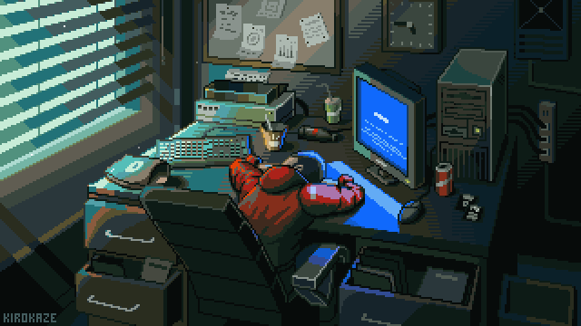

## `$ cat ~/about.txt`

  

I build web applications end to end, from the database schema up to the screen somebody uses at work. Most of my year went into operational software for small businesses: stock in a warehouse, a product catalogue, a sales ledger that has to still add up six months later. Laravel and PHP on one side, Next.js with TypeScript on the other, PostgreSQL underneath.

Finishing a Computer Science degree at Universitas Pasundan, Bandung, and available for full time work.

## `$ ls -la ~/projects`

Most of what I am proudest of lives in private repositories, so it is not browsable here. This is what is behind those names.

| Project | What it is |
|---|---|
| **Sarasa Inventori** &nbsp;`private` | Warehouse software for a home bakery. Production goes in, stock is tracked per batch, goods are consigned to shops, returns come back, and expired stock is written off. Stock rules live in the database across 29 SQL migrations |
| **Rumah Kue Sarasa** &nbsp;`private` | The public catalogue for the same bakery, with an admin panel and a chat assistant that recommends a product and hands the buyer to WhatsApp with the message already written |
| **Warehouse and Sales** &nbsp;`private` | Stock and multi item sales for a shop, with weekly, monthly and yearly reports and CSV export. Stock is computed from transaction history rather than stored, so a late correction never leaves the ledger out of step |
| **[Hikamah API](https://github.com/KakaPradithaa/Hikamah-Api)** | REST API for an Islamic boarding school: four roles with different authority, admin, teacher, homeroom teacher and student. Auth layer and access middleware written by hand, sessions kept in the database |
| **[Workshop App](https://github.com/KakaPradithaa/Tubes_Prakmob)** &nbsp;+&nbsp; **[its API](https://github.com/KakaPradithaa/RESTAPI_Tubes_Prakmob)** | Android app for a vehicle workshop with two roles. Customers register a vehicle, book a service and follow its status; admins publish services and move orders along. Laravel and Sanctum behind it |
| **[PasJajan](https://github.com/project-hexa/pasjajan)** &nbsp;`team of 15` | Digital grocery commerce, a monorepo with a Next.js front end and a Laravel API. My share of the commits is small and I say so plainly; what I took from it was working inside a codebase that size |

## `$ ls ~/skills`

  

That reading weighs my public repositories by bytes, which makes it heavier on coursework than on work. The working day looks like this.

**Every day.** TypeScript · Next.js App Router · React · Tailwind CSS · PHP · Laravel · Blade · PostgreSQL · MySQL

**Also in the toolbox.** Express · Node.js · Supabase · PL/pgSQL · Laravel Sanctum · shadcn/ui · Vite · Git

**Used on a real project.** Kotlin · Android · Jetpack Compose · Room · Java · MyBatis

## `$ snake --eat=contributions`

  

## `$ ssh connect`

  
  

Kaka Praditha Putra · Bandung, Indonesia · <a href="https://www.gitskins.com/readme-generator?template=community-green-screen-rl3j">Green Screen</a> template by <a href="https://www.gitskins.com/templates">GitSkins</a>

